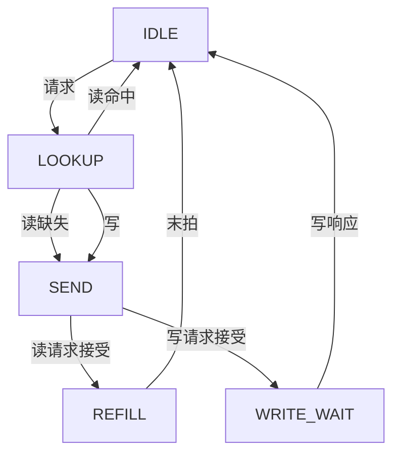

# 架构与接口

## 系统边界

本设计是单核、单时钟、32 位小端的 RV32IM 处理器子系统。复位为高有效同步复位，`RESET_PC` 默认为 0，要求四字节对齐。RTL 的外部存储地址宽度为 32 位；64KB 是测试平台 RAM 的容量，并非 CPU 地址位宽限制。

CPU 在机器模式运行，提供基础 CSR 和同步异常处理。没有外部中断、计时器中断、U/S 模式、PMP、MMU、A/C/F/D 扩展、调试模块或缓存一致性。本工程未执行官方架构认证套件，不声明完整特权规范符合性。

## 五级流水线

| 级 | 保存的信息 | 工作 |
|---|---|---|
| IF | `f_valid/f_pc/f_insn/f_error`，另有取指请求跟踪 | 将 I-Cache 响应存入一级缓冲 |
| ID | `id_valid/id_pc/id_insn/id_error` | 解析源寄存器用途，读取寄存器，检查 load-use |
| EX | `ex_valid/ex_pc/ex_insn/ex_a/ex_b` | ALU、分支/跳转、地址、CSR 运算、乘除法 |
| MEM | `mem_valid` 和事务上下文 | 执行阻塞访存，判定总线错误，处理异常与 CSR |
| WB | `wb_valid/wb_rd/wb_result` 和退休上下文 | 写回寄存器并输出退休记录 |

每级由 valid 位表示有效指令，通过当前指令是否完成决定是否接受下一级输入。MEM 在请求和响应之间保存地址、写数据、字节使能、目的寄存器和异常信息。

取指最多一个请求在途；IF 响应缓冲有空位时才发送新请求。Cache 的命中响应也经过 LOOKUP，当前前端限制了吞吐量。五级划分用于展示冒险、精确异常和通道解耦；下一步性能优化可以针对取指请求流水化，但当前实现不承诺每拍退休一条指令。

### 数据冒险

- EX 操作数优先取 MEM 可用结果，再取 WB，最后取 EX 保存的寄存器值。
- MEM 中的 load 只有完成响应后才允许前递；未完成时全局反压使 EX 保持。
- EX load 与 ID 源寄存器相关时插入 load-use 气泡。判断依据是指令真正使用的 rs1/rs2，避免把立即数字段当作源寄存器。
- WB 与 ID 同拍时提供显式旁路，避免依赖寄存器堆的读写实现习惯。
- EX 暂停时持续保存已前递的操作数，防止生产者离开 MEM/WB 后丢失新值。
- x0 读值固定 0，所有写入被丢弃。

### 控制冒险与异常

分支和跳转在 EX 解析。重定向清空 IF 和 ID；已经发出的 I-Cache 请求会继续完成，但响应通过 `fetch_drop` 丢弃。MEM 异常优先于 EX 重定向，同拍禁止年轻 EX 指令进入 MEM，并清空 EX。

异常按原程序顺序经过 MEM/WB。访存异常禁止请求，访问错误则在 AXI 响应后形成异常。故障指令不写回、不计入 retired，退休 trace 的 trap 字段用于验证其 PC/cause/tval。更老的 WB 可以正常完成，年轻 store 没有机会发出。

CSR、FENCE 和 MRET 在 EX 等到旧 MEM/WB 清空，保证读取最新 CSR，并使前面的写直达事务完成。FENCE 不使用写缓冲，所以通过排空旧指令实现当前单核范围内的排序。

## 乘除法器

EX 第一次进入 M 指令时发出单拍 start；操作数和 funct3 被乘除法器锁存。EX 等待 32 拍运算结束并保存结果，再将结果送到 MEM。

乘法：根据 MULH/MULHSU/MULHU 的符号规则求操作数绝对值，用 64 位移位加法计算乘积，最后恢复乘积符号并选低/高 32 位。MUL 低半部分可直接按无符号计算。

除法：每拍移入被除数的一位，对 33 位试除余数进行比较/减法，产生一位商。最终对商和余数恢复符号。RTL 不使用乘、除、取模运算符。

| 边界 | 行为 |
|---|---|
| DIV/DIVU 除数为零 | 商为 `0xFFFFFFFF` |
| REM/REMU 除数为零 | 返回原被除数 |
| `0x80000000 / 0xFFFFFFFF` 的有符号溢出 | 商为 `0x80000000`，余数为 0 |
| 一般有符号除法 | 商向零截断；非零余数与被除数同号 |

32 拍指运算阶段，包含请求/结果握手的整条流水线指令耗时更长。

## Cache

I/D Cache 各 4KB：256 行 × 4 字 × 4 字节，20 位 tag。地址分解：tag `[31:12]`、index `[11:4]`、word `[3:2]`、byte `[1:0]`。每个 Cache 只服务一个请求。

CPU 传入数据地址、32 位数据和 WSTRB；Cache 按字返回，CPU 负责 load 的字节选择和符号扩展。SB/SH 写数据和使能在 CPU 中按地址低位移位。非对齐 halfword/word 在 CPU 产生异常。

- 读缺失：使当前行无效，发送 16B 对齐的读请求，逐拍写入数据；只有全部响应成功且最后一拍位置正确才设置 valid/tag。
- 回填中任意一拍出错：向 CPU 返回 error，禁止安装该行，后续访问重新回填。
- 写命中：总线写成功后根据 WSTRB 合并更新命中数据；写失败保留原缓存内容。
- 写缺失：仅写总线，不分配新行，也不驱逐当前同 index 的其他 tag。
- FENCE.I：清空 I-Cache valid，并标记在途回填为 poison。旧请求可以返回，但不能重新安装一条旧行；CPU 同时丢弃旧取指并重定向到 FENCE.I 下一条指令。
- reset 清空 valid 和状态，数据/tag 阵列不清零，避免要求对 SRAM 内容逐字复位。

命中/缺失计数统计的是读请求。CPU 阻塞于 store，因此没有写缓冲及 store-to-load 绕过。

## AXI4

顶层导出 AR/R/AW/W/B 必要信号及 1 位 ID。外部集成若需要完整 AXI4 信号集合，应在包装层补充 ARPROT/AWPROT、ARCACHE/AWCACHE、LOCK、QOS 等属性，并结合实际地址空间定义。

| 参数 | 配置 |
|---|---|
| 地址/数据宽度 | 32/32 位 |
| 读 | ARLEN=3，ARSIZE=2，ARBURST=INCR；起始地址 16B 对齐 |
| 写 | AWLEN=0，AWSIZE=2，AWBURST=INCR；字对齐地址 + WSTRB |
| ID | 指令读 0，数据读/写 1 |
| Outstanding | 读最多 1 个 burst，写最多 1 个事务；可并行 |
| 读仲裁 | I/D 请求同时存在时轮询；最后服务 D 后优先 I，反之优先 D |
| 反压 | AR/AW/W VALID 与 payload 保持，直到各通道握手 |
| 写响应 | AW 和 W 分别跟踪；两者都完成后 BREADY 才有效 |
| 读响应 | 检查 RID/RRESP/RLAST，按锁存 owner 返回对应 Cache |

16B 对齐且固定 16B 的读 burst 保证不会跨 4KB；写为单个对齐 word。这里没有任意长度 burst 的 4KB 拆分器。

RREADY 在接收状态持续有效，Cache 可以每拍接收一拍回填。读写响应错误被传递成 CPU 访问异常。环境必须提供合规、完整且最终返回的响应；RLAST 错误会被标记，但本工程不承诺对损坏总线序列自动恢复。

## CSR 与异常范围

| CSR | 属性/约束 |
|---|---|
| mstatus `0x300` | MPP 固定 M；MIE/MPIE 可写；trap/MRET 更新对应位 |
| misa `0x301` | 固定 `0x40001100`，只读 |
| mtvec `0x305` | 只支持 direct 模式，写入时低 2 位清零 |
| mepc `0x341` | 写入低 2 位清零 |
| mcause `0x342` / mtval `0x343` | 读写，异常时更新 |
| mhartid `0xF14` | 固定 0，只读 |

对未实现 CSR、只读 CSR 的写操作和非法 SYSTEM 编码，产生非法指令异常。CSRRS/CSRRC（含立即数形式）rs1/zimm=0 时只读。

同步异常 cause：0 指令地址非对齐，1 指令访问错误，2 非法指令，3 断点，4 load 非对齐，5 load 访问错误，6 store 非对齐，7 store 访问错误，11 M-mode ECALL。trap 写 mepc/mcause/mtval 并跳转 mtvec；MRET 从 mepc 返回。

## 集成约束

Cache 默认覆盖全部地址空间，当前没有设备地址的 uncached 旁路。测试平台的 `0xFFF0` 是普通 RAM 中由 testbench 观察的完成标记，不能直接当作真实设备 MMIO 设计。接入有副作用的外设前，应增加不可缓存地址区域和单拍设备读路径。

Yosys 保留了 I/D 的数据/tag 存储器与寄存器堆。SRAM 宏或 FPGA BRAM 的实际推断，需要匹配目标器件的端口、读延迟和字节写使能；当前结构综合通过不代表已经完成物理映射和时序收敛。
